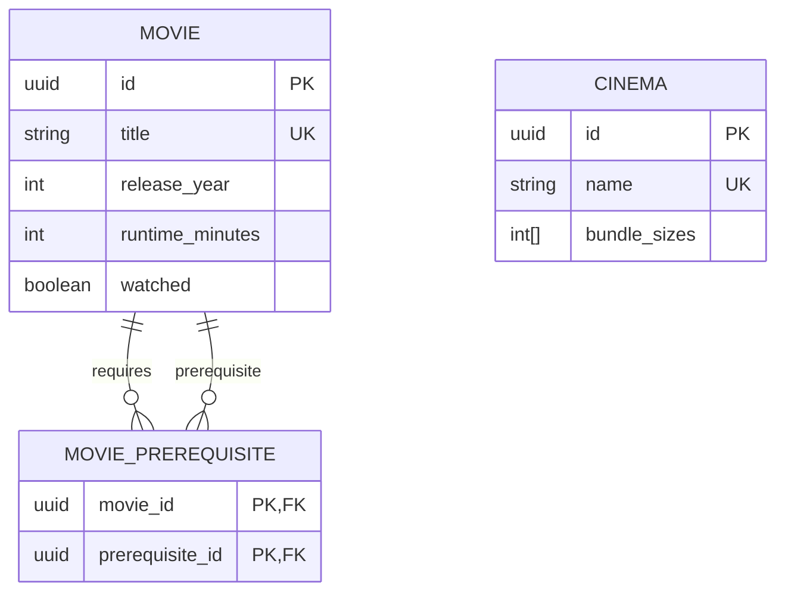

# MCU Movies and Cinema Booking

This repository contains an MCU movie prerequisite tracker and a cinema bundle
booking feature.

## What the app does

The app has two main features:

1. **MCU movie tracker** - add and edit movies, record release year and runtime,
   mark movies as watched, and define prerequisite movies.
2. **Cinema booking** - create cinemas with the seat bundles they sell and
   calculate the smallest exact set of bundles for a group size.

The movie details page expands a movie's prerequisite graph into a watch chain.
It shows the movies in dependency order, whether each one has been watched, and
progress such as `2/10 watched`.

## Architecture

- **Frontend:** Next.js, React, TypeScript, and Tailwind CSS.
- **Backend:** NestJS, TypeORM, PostgreSQL, and class-validator.
- **Communication:** the frontend calls the backend through server actions and
  Axios.
- **Persistence:** PostgreSQL stores movies, the self-referencing movie
  prerequisite table, and cinemas.

The backend exposes movie routes under `/movies` and cinema routes under
`/cinemas`. The cinema frontend is available at `/cinema`.

## Deployment

The application is deployed on AWS EC2:

- **Frontend:** <https://blinto-doomsday.mu-bin.dev/>
- **Backend API:** <https://api-blintodoomsday.mu-bin.dev/>

The deployed frontend uses the backend API URL through the
`NEXT_PUBLIC_API_URL` environment variable.

### Important implementation details

- Movie prerequisites use a join table because one movie can require many other
  movies, and one movie can be a prerequisite for many movies.
- The watch-order service walks the prerequisite graph recursively and uses a
  visited set to avoid duplicate movies and infinite loops.
- Updating a movie updates its normal fields and replaces its prerequisite link
  records in one database transaction.
- Cinema booking uses dynamic programming. For each seat total up to 10,000,
  the algorithm records the fewest bundles needed and the bundle size selected.
  It can therefore return either an exact minimum quote or `Not possible`.

## Run everything with Docker Compose

From the repository root:

```bash
docker compose up --build
```

Open the frontend at <http://localhost:3000>. The backend API is available at
<http://localhost:3001>.

To stop the stack:

```bash
docker compose down
```

The PostgreSQL data is stored in the `postgres_data` Docker volume.

## Data model



`MOVIE_PREREQUISITE` is a self-referencing join table. A `CINEMA` stores the
unique bundle sizes it sells.

## Main routes

- `/` - movie list
- `/cinema` - create cinemas and request booking quotes
- `/movie/add-movie` - add a movie
- `/movie/:id` - edit a movie and its prerequisites
- `/movie/details/:id` - view the prerequisite watch chain

## Main API endpoints

- `GET /movies` - list movies ordered by release year.
- `POST /movies` - create a movie and its prerequisite links.
- `PATCH /movies/:id` - update movie details and prerequisite links.
- `GET /movies/:id/watchorder` - return the recursive prerequisite chain.
- `POST /cinemas` - create a cinema with unique bundle sizes.
- `GET /cinemas` - list cinemas.
- `POST /cinemas/:id/quote` - calculate the minimum exact bundle quote.

## Challenges and solutions

### Recursive prerequisite chains

Prerequisites are not always one level deep. A movie may require a movie that
requires another movie. The backend recursively expands each prerequisite and
tracks visited IDs so shared prerequisites appear once and circular data cannot
cause an endless traversal.

### Updating prerequisite relationships

Prerequisites are stored in a separate join table, so a normal movie update
cannot update them as if they were a column on `movies`. The update flow
separates movie fields from prerequisite IDs, updates the movie, deletes the old
links, and inserts the new links inside one transaction.

### Exact minimum cinema bundles

A greedy strategy does not always produce the fewest bundles. For example,
bundle sizes `6, 9, 20` and group size `44` require `20 x 1`, `9 x 2`, and
`6 x 1`, which is four bundles. The dynamic-programming solution checks all
valid totals and reconstructs the minimum combination.

### Frontend and runtime configuration

The frontend and backend run on different ports and can also run in Docker.
The frontend API URL is configured through `NEXT_PUBLIC_API_URL`, while Docker
Compose supplies database settings and exposes the frontend on port 3000 and
backend on port 3001.

## AI assistance disclosure

AI was used as an assistant throughout development, not as a replacement for
the implementation decisions. I used it to discuss and compare approaches,
think through the architecture, and predict possible outcomes before testing
them.

Specific areas where AI assistance was used include:

- planning the application architecture and the separation between the movie
  and cinema features;
- setting up database migrations and seed handling;
- setting up Docker and Docker Compose configuration;
- setting up and reviewing Swagger/API documentation configuration;
- discussing approaches for recursive prerequisite chains and the minimum
  exact-bundle algorithm;
- validating and testing features after implementation, including reviewing
  build output, lint results, and runtime errors;
- predicting edge cases and expected outcomes before verifying them in the
  application;

The final implementation, feature decisions, debugging, validation, and tests
were reviewed against the challenge requirements. The core prerequisite-chain
and bundle-selection logic was implemented specifically for this application.
